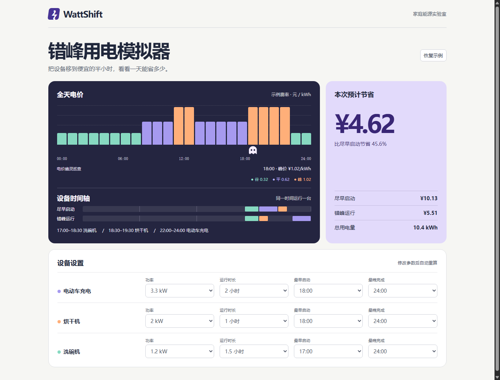

# WattShift · 瓦时

WattShift helps households schedule EV charging, laundry drying and dishwashing around time-of-use electricity prices. Set a time window, power draw and runtime for each appliance. The planner finds the cheapest non-overlapping schedule and compares its cost with starting as early as possible. Drag the ghost across the chart to inspect hourly rates. Everything runs locally in the browser.

## 运行

双击 `index.html` 即可使用。也可以在项目目录运行 `python -m http.server 8000 --bind 127.0.0.1`，在浏览器打开 `http://127.0.0.1:8000`。页面使用原生 HTML、CSS 和 JavaScript，无需安装依赖或配置账号。

## 一分钟演示

1. 打开默认场景。三台设备合计用电 10.4 kWh。把电动车充电安排到 22:00–24:00 后，整组任务的预计电费从 ¥10.13 降到 ¥5.51。
2. 把电动车的「最晚完成」改为 22:00，观察低价时段如何重新分配给其他设备。
3. 把电动车的「最早启动」也改成 22:00。两小时的充电任务放不进这个窗口，页面会显示冲突。点击「恢复示例」即可重来。

## 计算方法

一天分为 48 个半小时。每台设备以固定功率连续运行，同一时间仅运行一台。动态规划按当前时段与已完成的设备集合缓存结果，在等待和启动可用设备之间选择总价最低的可行方案。对照组按时间先后尝试启动，优先采用列表中首个能让全部设备按时完成的选择。两种方案使用相同的费率和用电量。

演示费率分别为谷价 ¥0.32、平价 ¥0.62、峰价 ¥1.02 每千瓦时。省费比例基于未舍入金额。费率为模拟数据，演示结果用于比较同一组设备的排程。

## 测试与发布

在 Node.js 18 或更新版本中运行 `node --test planner.test.js`。发布到 GitHub Pages 时，在公开仓库的 **Settings → Pages** 中选择 **Deploy from a branch → main → /(root)**。

项目采用 MIT 许可证。Kiro 的项目约束位于 `.kiro/steering/planner.md`。
